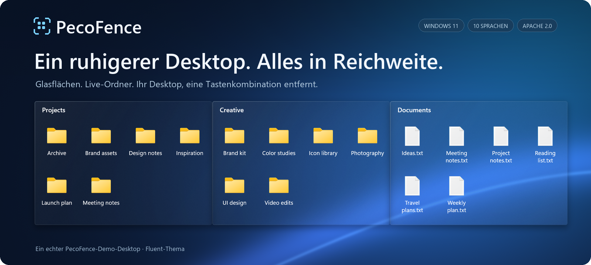
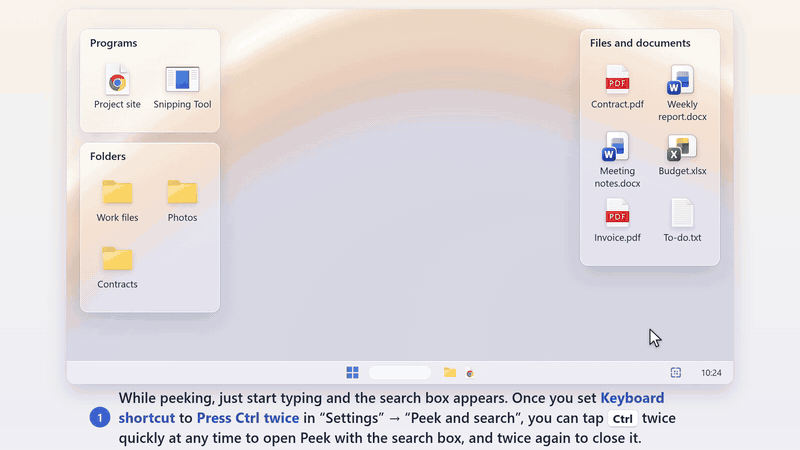
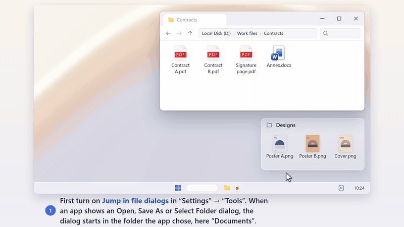
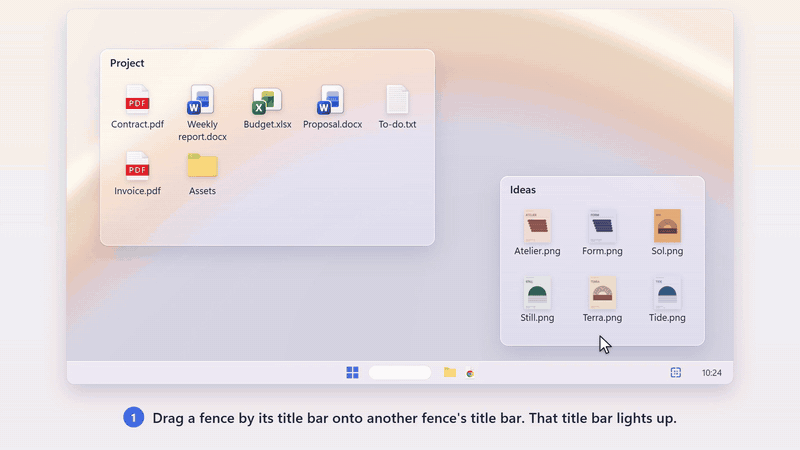
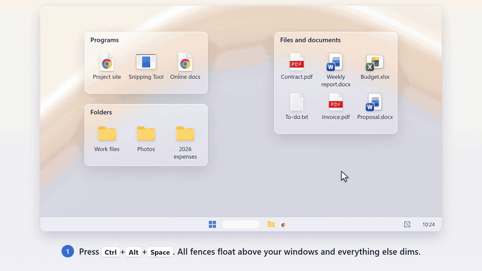
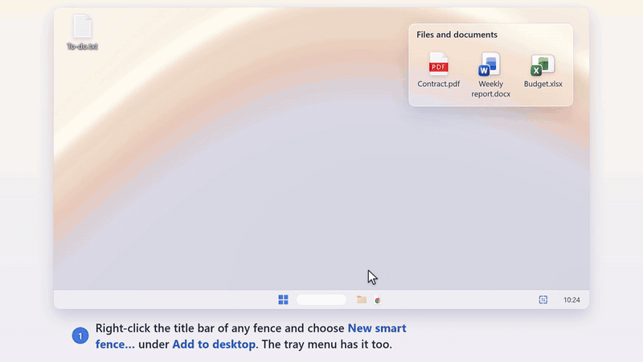
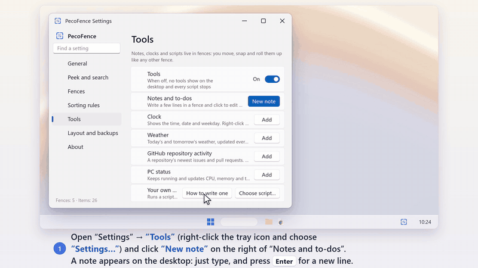

https://github.com/user-attachments/assets/c827f059-cfd7-4f6a-bed3-8b00411a7220

<p align="center">
  <strong>Eine kostenlose Open-Source-Alternative zu Stardock Fences für Windows 11.</strong><br>
  Sammle Dateien in Glas-Panels, wechsle Projekte per Tab und lass deinen KI-Agenten Layout, Aussehen und Sortierregeln über die integrierte CLI einstellen.
</p>

<p align="center">
  <a href="https://pecofence.jiang.jp/de/"><strong>Website</strong></a>
  &nbsp;·&nbsp; <a href="#pecofence-herunterladen"><strong>PecoFence herunterladen →</strong></a>
  &nbsp;·&nbsp; <a href="#dein-desktop-von-deiner-ki-eingerichtet"><strong>KI + CLI</strong></a>
  &nbsp;·&nbsp; <a href="#pecofence-in-aktion">In Aktion sehen</a>
  &nbsp;·&nbsp; <a href="../README.md">Dokumentation</a>
</p>

<p align="center">
  <a href="../../README.md">English</a>
  &nbsp;·&nbsp; <a href="README.zh-CN.md">简体中文</a>
  &nbsp;·&nbsp; <a href="README.zh-TW.md">繁體中文</a>
  &nbsp;·&nbsp; <a href="README.ja.md">日本語</a>
  &nbsp;·&nbsp; <a href="README.ko.md">한국어</a>
  &nbsp;·&nbsp; <strong>Deutsch</strong>
  &nbsp;·&nbsp; <a href="README.fr.md">Français</a>
  &nbsp;·&nbsp; <a href="README.es.md">Español</a>
  &nbsp;·&nbsp; <a href="README.pt-BR.md">Português (Brasil)</a>
  &nbsp;·&nbsp; <a href="README.ru.md">Русский</a>
  &nbsp;·&nbsp; <a href="README.it.md">Italiano</a>
</p>

---

<a id="lassen-sie-ihre-ki-aufräumen"></a>

## Dein Desktop. Von deiner KI eingerichtet

**CLI inklusive. Bereit für deinen KI-Agenten.**

Sag deinem KI-Agenten, wie du deinen Desktop nutzen möchtest. Mit der mitgelieferten `pecofence-cli` können Claude Code, Codex und Cursor deine aktuelle Konfiguration lesen und Änderungen direkt in PecoFence anwenden.

- **Mit eigenen Worten konfigurieren.** Ändere Design, Transparenz, Symbolgröße und globale Einstellungen oder passe alle Bereiche auf einmal an.
- **Einmal sortieren, dauerhaft Ordnung halten.** Erstelle Projektbereiche, ordne Symbole zu und lege Regeln an, die neue Dateien automatisch einsortieren.
- **Deine Einrichtung bewahren.** Momentaufnahmen speichern Bereichslayouts; der Konfigurationsexport und -import sichert Einstellungen, Regeln und Layouts und stellt sie wieder her.

**Mit deinem KI-Agenten ausprobieren**

Starte PecoFence und füge diese Anfrage in deinen KI-Coding-Agenten ein:

> Konfiguriere meinen Desktop mit pecofence-cli. Lies zuerst pecofence-cli skill und pecofence-cli describe und prüfe dann meine aktuellen Einstellungen und Bereiche. Sichere die Konfiguration vor Änderungen. Aktiviere den dunklen Modus und mache alle Bereiche transparenter.

Die CLI ist enthalten. Die Microsoft-Store-Version fügt `pecofence-cli` zum PATH hinzu. Beim portablen ZIP gib deinem Agenten den vollständigen Pfad zu `pecofence-cli.exe`.

<details>
<summary><strong>Beispielgespräch mit einem Coding-Agenten</strong></summary>

> Sammle die PDFs auf meinem Desktop in einem Docs-Bereich und sortiere neue PDFs automatisch dort ein. Aktiviere den dunklen Modus und mache die Bereiche transparenter.

```powershell
pecofence-cli config export "$env:USERPROFILE\pecofence-before-ai.json"
pecofence-cli snapshot save before-cleanup
pecofence-cli fence create --title Docs
pecofence-cli rule add --name PDFs --ext pdf --to Docs --index 0
pecofence-cli rule apply
pecofence-cli settings set theme dark
pecofence-cli fence set --all opacity clear
```

</details>

Für Agenten und Skripte: `describe` liefert den Befehlskatalog und JSON-Schemas, `skill` den Agenten-Leitfaden. JSON-Ergebnisse zeigen die Änderungen; strukturierte Anwendungsfehler helfen dem Agenten, den nächsten Schritt zu wählen.

[Erste Schritte mit der CLI →](../CLI.md#start-with-your-ai-agent)

## Alles bekommt seinen Platz

<p align="center">
  
</p>

## PecoFence in Aktion

### Finden beim Tippen.

Drücke **Strg + Alt + Leertaste** und tippe los. Passende Dateien und Ordner aus deinen Bereichen
erscheinen sofort, und **Eingabe** öffnet einen Treffer. Chinesische Namen findest du auch per
Pinyin. Everything ist ein kostenloses Programm zur Dateisuche: Schaltest du in den Einstellungen
die Everything-Suche ein, wird auch der ganze Computer durchsucht. Der Clip nutzt „Zweimal Strg“,
das du in den Einstellungen als Tastenkombination wählen kannst.



### Der richtige Ordner in Öffnen- und Speichern-Dialogen.

Wechselst du in einem Öffnen- oder Speichern-Dialog zum Explorer und zurück, springt der Dialog in
den dort offenen Ordner. **Strg+G** springt auch dorthin, und ein Klick auf einen Ordnerbereich
führt in den Ordner dieses Bereichs. Die Funktion ist standardmäßig aus, und PecoFence bietet sie
an, wenn sie zum ersten Mal helfen kann. Auch wenn sie aus ist, hilft **Eingabe** auf einem
Suchtreffer beim Hervorholen dem Dialog: Ein Öffnen-Dialog öffnet die Datei, ein Speichern-Dialog
wechselt in ihren Ordner.



### Ein Bereich. Viele Projekte.

Halte zusammengehörige Bereiche als Tabs beisammen. Wechsle mit einem Klick
von Project zu Ideas und zieh einen Tab heraus, wenn du mehr Platz brauchst.



### Dein Desktop, nur eine Tastenkombination entfernt.

Drücke **Strg + Alt + Leertaste**, um deine Bereiche vor die aktuelle Anwendung zu holen.
Hol dir, was du brauchst, und kehre mit **Esc** zurück.



### Ein Bereich, der sich selbst füllt.

Ein intelligenter Bereich zeigt das aktuelle Ergebnis einer gespeicherten Suche. Wähle eine Vorlage
wie **Downloads der letzten 7 Tage** und klicke auf **Erstellen**: Neue passende Dateien erscheinen
von selbst, und die Dateien bleiben, wo sie sind.



### Notizen, eine Uhr und deine eigenen Skripte.

Du fügst sie unter **Einstellungen → Werkzeuge** hinzu: eine Notiz, in der Zeilen, die mit `[ ]`
beginnen, zu Aufgaben werden, eine Uhr mit Datum und Skriptbereiche, die zeigen, was ein Skript
ausgibt, etwa das Wetter.



Mehr im Handbuch: [eigene Bereiche für jeden virtuellen Desktop](https://pecofence.jiang.jp/de/manual/#vdesk) ([GIF](../assets/vdesk.gif)),
[Desktopsymbole, die bleiben, wo du sie hinlegst](https://pecofence.jiang.jp/de/manual/#free-place) ([GIF](../assets/free-place.gif)) und
[Strg+Z, um den letzten Schritt zurückzunehmen](https://pecofence.jiang.jp/de/manual/#undo) ([GIF](../assets/undo.gif)).

<sub>Animationen aus dem <a href="https://pecofence.jiang.jp/de/manual/">Handbuch</a>. Die GIFs laufen in Endlosschleife.</sub>

## Kleine Details, die den Alltag leichter machen

| Erlebnis | Was dahintersteckt |
| :--- | :--- |
| **KI + CLI** | `pecofence-cli`: **Mit eigenen Worten konfigurieren.** Ändere Design, Transparenz, Symbolgröße und globale Einstellungen oder passe alle Bereiche auf einmal an. |
| **Weniger sortieren** | Regeln nach Dateityp, Endung, Name, Platzhalter, Verknüpfungsziel, Zeit und Größe. Neue Dateien finden ihren Bereich von selbst. |
| **Intelligente Bereiche** | Ein Bereich, der das aktuelle Ergebnis einer Suche zeigt, etwa die Downloads der letzten 7 Tage oder alle Dateien über 1 GB. Die Dateien bleiben, wo sie sind. Strg+F filtert einen Ordnerbereich oder intelligenten Bereich beim Tippen. |
| **Eigene Bereiche je virtuellem Desktop** | Jeder virtuelle Desktop von Windows kann eigene Bereiche haben. Wechselst du den Desktop, blenden sich seine Bereiche ein. |
| **Glas, das zu deinem Desktop passt** | Die Designs Fluent und Liquid Glass, heller und dunkler Modus, Farbton, Deckkraft und Symbolfärbung je Bereich. |
| **Vertraute Dateiverwaltung** | Explorer-Kontextmenüs, Drag & Drop, Kopieren/Einfügen, Mehrfachauswahl, Miniaturansichten sowie Symbol-, Listen- und Detailansicht. |
| **Ordner in Reichweite** | Hol dir einen Live-Ordner auf den Desktop. Stöbere in Unterordnern und sieh Änderungen sofort. Die Zurück-Taste der Maus geht einen Ordner hoch, die Vorwärts-Taste wieder hinein. |
| **Platz, wenn du ihn brauchst** | Klappe einen Bereich bis auf den Titel ein. Zum Ausklappen einfach mit der Maus darauf zeigen. Sperre ein Layout, das dir gefällt. Ein Doppelklick auf den Desktop blendet alle Bereiche aus. Ein zweiter holt sie zurück. |
| **Kleine Werkzeuge in Bereichen** | Notizen mit Aufgaben, eine Uhr mit Datum und Skriptbereiche, die zeigen, was dein eigenes Skript ausgibt, etwa das Wetter; ein Klick auf eine Zeile kann einen Link öffnen oder eine Aufgabe abhaken. Du kannst sie gleich unter Einstellungen → Werkzeuge oder im Taskleistenmenü hinzufügen. |
| **Ein Weg zurück** | Layout-Momentaufnahmen, tägliche Sicherungen, Import/Export der Konfiguration und Tausch zwischen Bildschirmen. |
| **Einstellung suchen** | Tippe in das Feld oben in den Einstellungen (Strg+F), um jede Einstellung zu finden, über Wörter aus ihr oder über gängige andere Namen. |
| **Ein kleiner Fußabdruck** | Eine native Rust-Anwendung, die im Leerlauf nur etwa 2 bis 5 MB Arbeitsspeicher belegt (laut Task-Manager). Das Einstellungsfenster (WebView2) wird erst bei Bedarf geladen. |

Automatische Sortierregeln lassen Dateien an ihrem ursprünglichen Speicherort. Verschiebungen,
die du selbst anstößt, funktionieren wie im Explorer.

[Die vollständige Funktionsliste →](../FEATURES.md)

## PecoFence herunterladen

<a href="https://apps.microsoft.com/detail/9MV6WG3XNWSX?mode=direct"></a>

Die Microsoft-Store-Version ist von Microsoft signiert, aktualisiert sich automatisch und zeigt keine SmartScreen-Abfrage. Dieselbe App gibt es auch als:

- **Portables ZIP**: Lade `pecofence-v<Version>-x64-portable.zip` von der **Releases**-Seite dieses Repositorys herunter, entpacke die **gesamte ZIP-Datei** in einen Ordner und starte `pecofence.exe`.
- **Installer**: `pecofence-v<Version>-x64-setup.exe` auf derselben Seite installiert PecoFence für dein Windows-Konto, mit Startmenü-Eintrag und Deinstallationsprogramm.
- **winget**: `winget install DayuanJiang.PecoFence` installiert den portablen Build und überspringt die SmartScreen-Abfrage.

<details>
<summary><strong>Systemvoraussetzungen, Konfiguration und ein paar nützliche Hinweise</strong></summary>

- Windows 10 22H2 oder Windows 11 22H2 oder neuer. Für die Einstellungen wird die Microsoft Edge WebView2 Runtime benötigt. Windows 11 bringt sie mit; unter Windows 10 installiere sie von Microsoft, falls sich die Einstellungen nicht öffnen.
- Beim ersten Start werden die Bereiche „Programme“, „Ordner“, „Dateien und Dokumente“ und „Desktop“ in der gewählten Sprache angelegt. Beim Beenden erscheinen die Windows-Desktopsymbole wieder.
- Die Konfiguration liegt in `%APPDATA%\PecoFence\config.json`. Mit `--portable` gestartet, bleibt sie in einem Ordner `config` neben der ausführbaren Datei.
- ZIP und Installer sind nicht signiert. Fragt Windows SmartScreen beim ersten Start nach, wähle **Weitere Informationen → Trotzdem ausführen**.

[Anleitung zur portablen Version](../PORTABLE.md) · [Sprachen und Übersetzungen](../LOCALIZATION.md) · [Windows-Installationsanleitung](../INSTALLER.md)

</details>

## Selbst bauen. Selbst gestalten.

PecoFence steht unter der Apache-2.0-Lizenz, und Beiträge sind willkommen, von einer treffenderen
Übersetzung bis zu einer besseren Desktop-Interaktion.

[Mitwirken](../../CONTRIBUTING.md) · [Übersetzung verbessern](../LOCALIZATION.md) · [Entwicklerhandbuch](../DEVELOPMENT.md)

## Code signing policy

Kostenlose Codesignatur durch [SignPath.io](https://about.signpath.io/), Zertifikat von der [SignPath Foundation](https://signpath.org/).

- Commits und Reviews: [Dayuan Jiang](https://github.com/DayuanJiang)
- Freigabe der Signaturen: [Dayuan Jiang](https://github.com/DayuanJiang)

Signiert werden nur Dateien, die GitHub Actions aus einem Versions-Tag dieses Repositorys baut. Jede Signatur wird von Hand freigegeben.

**Datenschutz:** Dieses Programm überträgt keine Informationen an andere vernetzte Systeme, es sei denn, der Benutzer oder die Person, die es installiert oder bedient, verlangt das ausdrücklich. **Nach Updates suchen** fragt die GitHub-API ab. Was du unter **Feedback** sendest, geht an den Feedback-Dienst von PecoFence. Das Einstellungsfenster läuft auf Microsoft Edge WebView2. Dafür gilt die [Datenschutzerklärung von Microsoft](https://privacy.microsoft.com/privacystatement).

---

**Für einen Desktop, zu dem du gern zurückkehrst.**  
[Apache-2.0-Lizenz](../../LICENSE) · [Hinweise zu Drittanbietern](../../third_party/README.md)
