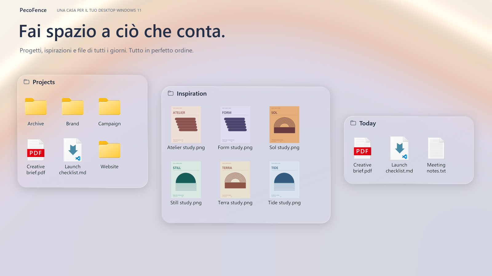
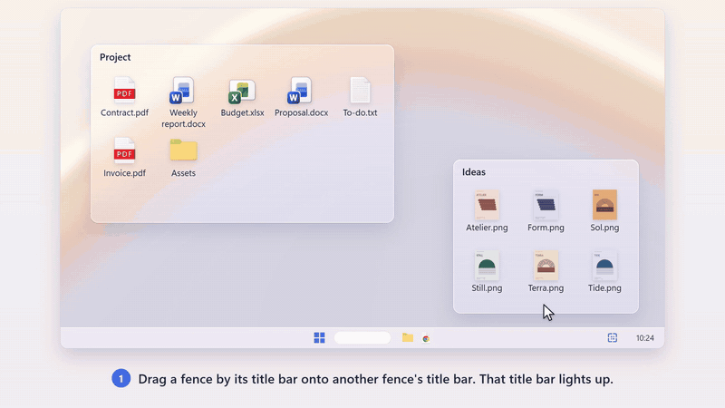
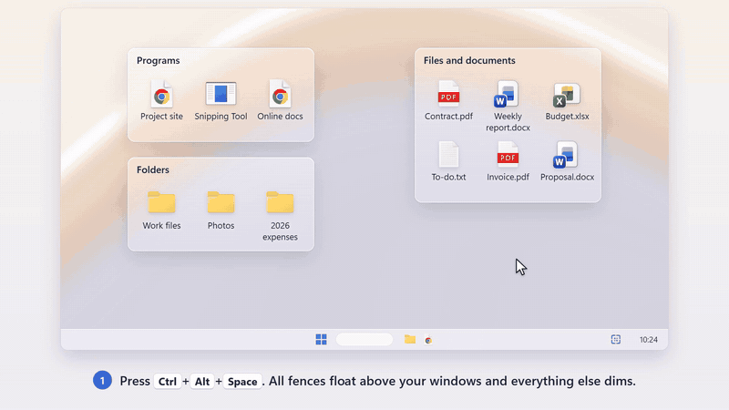

https://github.com/user-attachments/assets/c827f059-cfd7-4f6a-bed3-8b00411a7220

<p align="center">
  <strong>Un’alternativa gratuita e open source a Stardock Fences per Windows 11.</strong><br>
  Tieni i file in pannelli trasparenti, passa da un progetto all’altro con le schede e chiedi al tuo agente IA di configurare il layout, l’aspetto e le regole di organizzazione tramite la CLI integrata.
</p>

<p align="center">
  <a href="https://pecofence.jiang.jp/it/"><strong>Sito web</strong></a>
  &nbsp;·&nbsp; <a href="#scarica-pecofence"><strong>Scarica PecoFence →</strong></a>
  &nbsp;·&nbsp; <a href="#il-tuo-desktop-configurato-dalla-tua-ia"><strong>IA + CLI</strong></a>
  &nbsp;·&nbsp; <a href="#scoprilo-in-azione">Scoprilo in azione</a>
  &nbsp;·&nbsp; <a href="../README.md">Documentazione</a>
</p>

<p align="center">
  <a href="../../README.md">English</a>
  &nbsp;·&nbsp; <a href="README.zh-CN.md">简体中文</a>
  &nbsp;·&nbsp; <a href="README.zh-TW.md">繁體中文</a>
  &nbsp;·&nbsp; <a href="README.ja.md">日本語</a>
  &nbsp;·&nbsp; <a href="README.ko.md">한국어</a>
  &nbsp;·&nbsp; <a href="README.de.md">Deutsch</a>
  &nbsp;·&nbsp; <a href="README.fr.md">Français</a>
  &nbsp;·&nbsp; <a href="README.es.md">Español</a>
  &nbsp;·&nbsp; <a href="README.pt-BR.md">Português (Brasil)</a>
  &nbsp;·&nbsp; <a href="README.ru.md">Русский</a>
  &nbsp;·&nbsp; <strong>Italiano</strong>
</p>

---

<a id="chiedi-alla-tua-ia-di-organizzarlo"></a>

## Il tuo desktop. Configurato dalla tua IA

**CLI integrata. Pronta per il tuo agente IA.**

Spiega al tuo agente IA come vuoi organizzare il desktop. `pecofence-cli`, incluso nel programma, consente a Claude Code, Codex e Cursor di leggere la configurazione attuale e applicare le modifiche direttamente in PecoFence.

- **Configuralo con parole tue.** Cambia temi, trasparenza, dimensioni delle icone e impostazioni globali, oppure modifica tutti i riquadri contemporaneamente.
- **Organizza una volta. Mantieni l’ordine.** Crea riquadri per i progetti, disponi le icone e aggiungi regole che organizzano automaticamente i nuovi file.
- **Salva una configurazione che ti piace.** Usa le istantanee per il layout dei riquadri e l’esportazione e l’importazione della configurazione per impostazioni, regole e layout.

**Provalo con il tuo agente IA**

Apri PecoFence, poi incolla questa richiesta nel tuo agente IA di programmazione:

> Usa pecofence-cli per configurare il mio desktop. Per prima cosa leggi pecofence-cli skill e pecofence-cli describe, poi controlla le impostazioni e i riquadri attuali. Fai un backup della configurazione prima di apportare modifiche. Passa alla modalità scura e rendi tutti i riquadri più trasparenti.

La CLI è inclusa. L’edizione Microsoft Store aggiunge `pecofence-cli` al PATH. Se usi lo ZIP portatile, indica al tuo agente il percorso di `pecofence-cli.exe`.

<details>
<summary><strong>Esempio di conversazione con un agente di programmazione</strong></summary>

> Metti i PDF del desktop in un riquadro Docs, tieni lì i nuovi PDF, passa alla modalità scura e rendi i riquadri più trasparenti.

```powershell
pecofence-cli config export "$env:USERPROFILE\pecofence-before-ai.json"
pecofence-cli snapshot save before-cleanup
pecofence-cli fence create --title Docs
pecofence-cli rule add --name PDFs --ext pdf --to Docs --index 0
pecofence-cli rule apply
pecofence-cli settings set theme dark
pecofence-cli fence set --all opacity clear
```

</details>

Progettato per agenti e script: `describe` mostra il catalogo dei comandi e gli schemi JSON; `skill` stampa la guida per gli agenti. I risultati JSON indicano cosa è cambiato e gli errori strutturati dell’applicazione aiutano l’agente a scegliere il passaggio successivo.

[Inizia a usare la CLI →](../CLI.md#start-with-your-ai-agent)

## Ogni cosa al suo posto

<p align="center">
  
</p>

## Scoprilo in azione

### Un riquadro. Più spazi di lavoro.

Tieni insieme i riquadri correlati come schede. Passa da Project a Ideas con un clic,
poi trascina fuori una scheda quando ti serve più spazio.



### Il desktop, a portata di scorciatoia.

Premi **Ctrl + Alt + Spazio** per portare i riquadri in primo piano sopra l’app aperta.
Prendi quello che ti serve, poi premi **Esc** per tornare indietro.



<sub>Animazioni dal <a href="https://pecofence.jiang.jp/it/manual/">manuale</a>. Le GIF si ripetono automaticamente.</sub>

## Piccoli dettagli che fanno la differenza

| Funzione | Cosa ottieni |
| :--- | :--- |
| **IA + CLI** | `pecofence-cli`: **Configuralo con parole tue.** Cambia temi, trasparenza, dimensioni delle icone e impostazioni globali, oppure modifica tutti i riquadri contemporaneamente. |
| **Meno ordine manuale** | Regole per tipo di file, estensione, nome, caratteri jolly, destinazione dei collegamenti, data e dimensione. I nuovi file trovano da soli il loro riquadro. |
| **Un vetro che si adatta al desktop** | Temi Fluent e Liquid Glass, modalità chiara e scura, colori, opacità e colorazione delle icone per ogni riquadro. |
| **Gestione dei file familiare** | Menu contestuali di Esplora file, trascinamento, copia e incolla, selezione multipla, miniature e viste a icone, elenco o dettagli. |
| **Le cartelle a portata di mano** | Metti una cartella attiva sul desktop. Sfoglia le sottocartelle e guarda le modifiche comparire man mano che avvengono. |
| **Spazio quando serve** | Comprimi un riquadro fino al titolo. Passaci sopra con il puntatore per espanderlo. Blocca il layout quando ti soddisfa. Fai doppio clic sul desktop per nascondere i riquadri e di nuovo per mostrarli. |
| **Un modo per tornare indietro** | Istantanee del layout, backup giornalieri, importazione ed esportazione della configurazione e scambio dei riquadri tra i monitor. |
| **Ingombro ridotto** | Un’applicazione nativa scritta in Rust che, quando è inattiva, usa circa 40 MB di memoria in Gestione attività. Il pannello delle impostazioni in WebView2 si carica solo quando serve. |

Le regole di organizzazione automatica lasciano i file nella loro posizione originale.
Gli spostamenti avviati da te funzionano come in Esplora file.

[Scopri l’elenco completo delle funzioni →](../FEATURES.md)

## Scarica PecoFence

<a href="https://apps.microsoft.com/detail/9MV6WG3XNWSX?mode=direct"></a>

L’edizione Microsoft Store è firmata da Microsoft, si aggiorna automaticamente e non mostra mai l’avviso di SmartScreen. La stessa app è disponibile anche come:

- **ZIP portatile**: scarica `pecofence-v<version>-x64-portable.zip` dalla pagina **Releases** di questo repository, estrai **l’intero ZIP** in una cartella ed esegui `pecofence.exe`.
- **Programma d’installazione**: `pecofence-v<version>-x64-setup.exe`, nella stessa pagina, installa PecoFence per il tuo utente Windows, con una voce nel menu Start e un programma di disinstallazione.
- **winget**: `winget install DayuanJiang.PecoFence` installa la versione portatile e salta l’avviso di SmartScreen.

<details>
<summary><strong>Requisiti, configurazione e qualche nota utile</strong></summary>

- Windows 10 22H2, oppure Windows 11 22H2 o versioni successive. Le Impostazioni richiedono Microsoft Edge WebView2 Runtime. È già incluso in Windows 11; su Windows 10 installalo dal sito di Microsoft se le Impostazioni non si aprono.
- Al primo avvio vengono creati quattro riquadri nella lingua scelta: Programmi, Cartelle, File e documenti e Desktop. Le icone del desktop di Windows ricompaiono quando esci.
- La configurazione si trova in `%APPDATA%\PecoFence\config.json`. Avvia il programma con `--portable` per tenerla in una cartella `config` accanto all’eseguibile.
- Lo ZIP e il programma d’installazione non sono firmati. Se al primo avvio compare Windows SmartScreen, scegli **Ulteriori informazioni → Esegui comunque**.

[Guida all’edizione portatile](../PORTABLE.md) · [Guida alle lingue](../LOCALIZATION.md) · [Guida al programma d’installazione per Windows](../INSTALLER.md)

</details>

## Compilalo. Rendilo tuo.

PecoFence è distribuito con licenza Apache 2.0 e i contributi sono benvenuti, da una traduzione più precisa
a un’interazione migliore con il desktop.

[Contribuisci](../../CONTRIBUTING.md) · [Migliora una traduzione](../LOCALIZATION.md) · [Guida allo sviluppo](../DEVELOPMENT.md)

---

**Pensato per un desktop a cui è un piacere tornare.**  
[Licenza Apache 2.0](../../LICENSE) · [Avvisi sulle licenze di terze parti](../../third_party/README.md)
