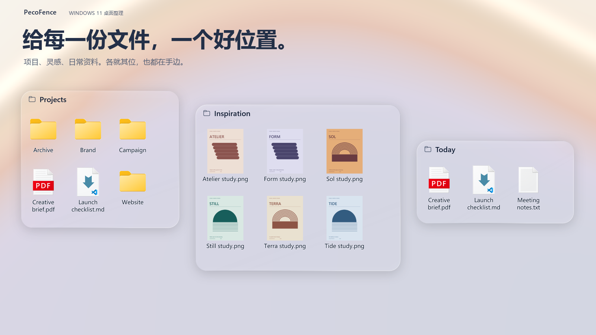
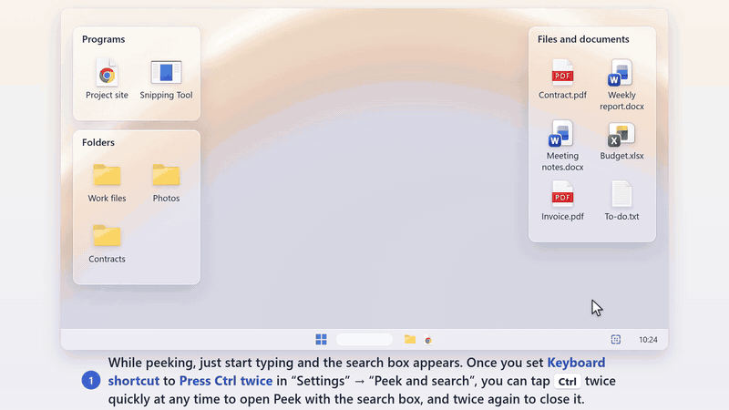
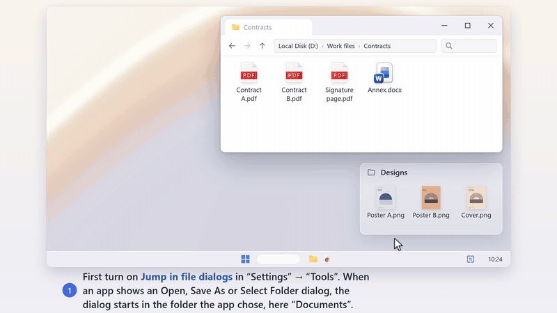
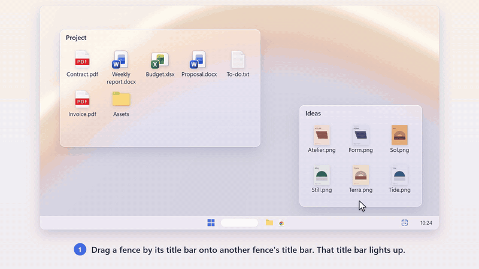
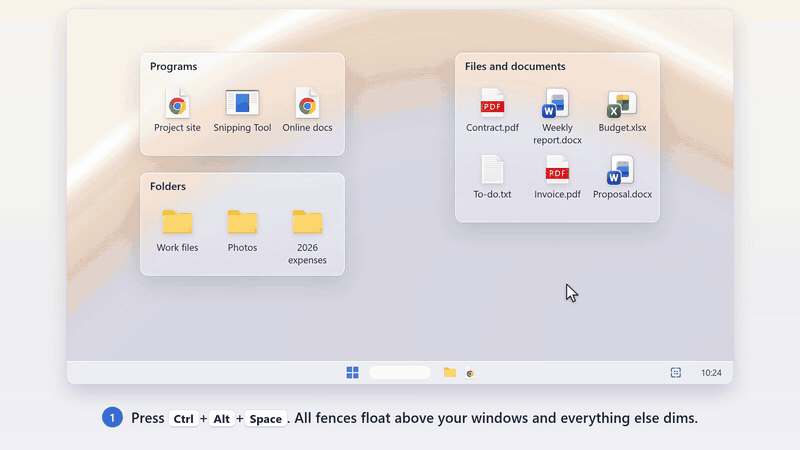
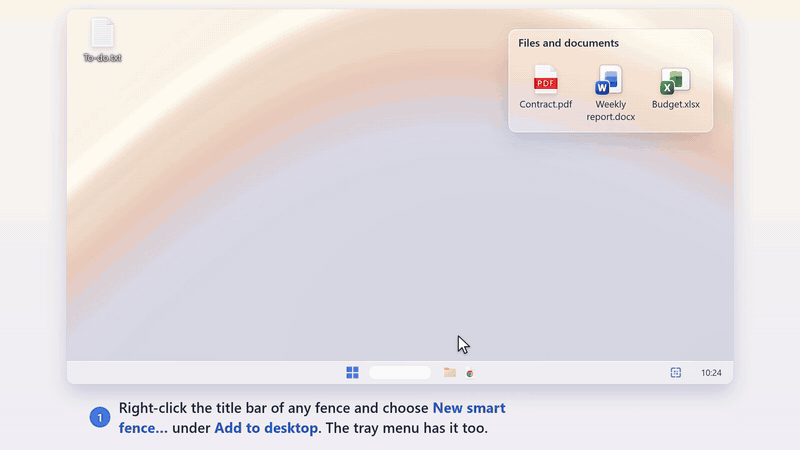
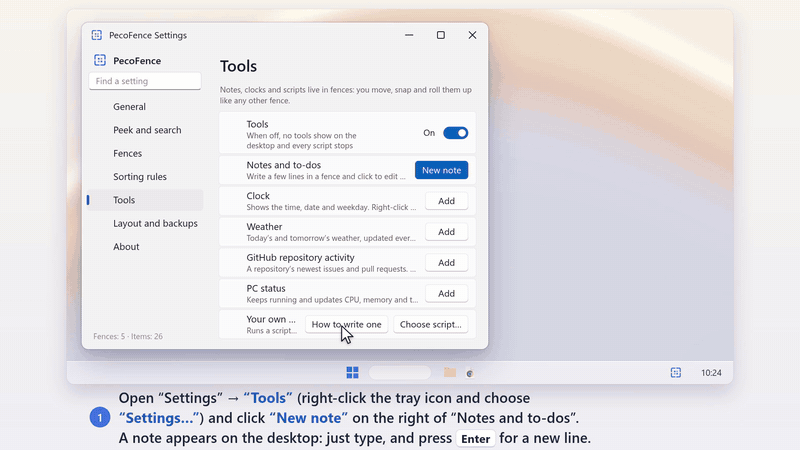

https://github.com/user-attachments/assets/c827f059-cfd7-4f6a-bed3-8b00411a7220

<p align="center">
  <strong>免费、开源的 Windows 11 桌面整理工具，可以替代 Stardock Fences。</strong><br>
  用玻璃栅栏收好文件，用标签页切换项目，还能让 AI 助手通过内置 CLI，直接调整布局、外观和自动整理规则。
</p>

<p align="center">
  <a href="https://pecofence.jiang.jp/zh-CN/"><strong>官网</strong></a>
  &nbsp;·&nbsp; <a href="#开始使用"><strong>下载使用 →</strong></a>
  &nbsp;·&nbsp; <a href="#桌面怎么配告诉-ai-就好"><strong>AI + CLI</strong></a>
  &nbsp;·&nbsp; <a href="#看看它怎么用">看看实际操作</a>
  &nbsp;·&nbsp; <a href="../README.md">项目文档</a>
</p>

<p align="center">
  <a href="../../README.md">English</a>
  &nbsp;·&nbsp; <strong>简体中文</strong>
  &nbsp;·&nbsp; <a href="README.zh-TW.md">繁體中文</a>
  &nbsp;·&nbsp; <a href="README.ja.md">日本語</a>
  &nbsp;·&nbsp; <a href="README.ko.md">한국어</a>
  &nbsp;·&nbsp; <a href="README.de.md">Deutsch</a>
  &nbsp;·&nbsp; <a href="README.fr.md">Français</a>
  &nbsp;·&nbsp; <a href="README.es.md">Español</a>
  &nbsp;·&nbsp; <a href="README.pt-BR.md">Português (Brasil)</a>
  &nbsp;·&nbsp; <a href="README.ru.md">Русский</a>
  &nbsp;·&nbsp; <a href="README.it.md">Italiano</a>
</p>

---

<a id="让-ai-帮你整理"></a>

## 桌面怎么配，告诉 AI 就好

**内置 CLI，让 AI 直接配置桌面**

把你想要的桌面告诉 AI 助手。PecoFence 自带 `pecofence-cli`，Claude Code、Codex、Cursor 可以读取当前配置，并直接在 PecoFence 中执行修改。

- **说出需求，直接改配置。** 切换主题，调整透明度、图标大小和全局设置，也能一次改好所有栅栏。
- **整理一次，以后自动归位。** 创建项目栅栏、整理图标，再添加规则，让新文件自动进入对应栅栏。
- **喜欢的配置，保存下来。** 用快照保存栅栏布局，用配置导入导出保存和恢复设置、规则与布局。

**现在就让你的 AI 助手试试**

启动 PecoFence，把下面这段话发给你的 AI 编程助手：

> 请用 pecofence-cli 帮我配置桌面。先阅读 pecofence-cli skill 和 pecofence-cli describe，再查看当前设置与栅栏。修改前先备份配置，然后切换为深色模式，并把所有栅栏调得更透明。

CLI 已随应用附带。Microsoft Store 版会把 `pecofence-cli` 加入 PATH；使用便携版时，告诉助手 `pecofence-cli.exe` 的完整路径即可。

<details>
<summary><strong>与编程助手的对话示例</strong></summary>

> 把桌面上的 PDF 放进 Docs 栅栏，以后的 PDF 也自动归进去，切成深色模式，再把栅栏调得更透明一点。

```powershell
pecofence-cli config export "$env:USERPROFILE\pecofence-before-ai.json"
pecofence-cli snapshot save before-cleanup
pecofence-cli fence create --title Docs
pecofence-cli rule add --name PDFs --ext pdf --to Docs --index 0
pecofence-cli rule apply
pecofence-cli settings set theme dark
pecofence-cli fence set --all opacity clear
```

</details>

为 AI 和脚本设计：`describe` 输出命令目录和 JSON Schema，`skill` 输出使用指南。每次执行都用 JSON 说明改了什么；出错时返回结构化错误，助手可以据此决定下一步。

[查看 CLI 上手指南 →](../CLI.md#start-with-your-ai-agent)

## 给每件事留一个位置

<p align="center">
  
</p>

## 看看它怎么用

### 打字就找到

按 **Ctrl + Alt + 空格**，然后直接打字。栅栏里名字对得上的文件和文件夹马上列出来，中文名打拼音也能搜到，按 **Enter** 打开。
Everything 是免费的文件搜索工具，在设置里开启 Everything 搜索后，整台电脑的文件也能搜到。
动图里用的是「双击 Ctrl」，可以在设置里把快捷键换成它。



### 打开、保存时直达文件夹

在「打开」「另存为」对话框里切到资源管理器，再切回来，对话框就会跳到资源管理器里正开着的文件夹。按 **Ctrl+G** 也能跳，点一下文件夹栅栏就跳到它显示的文件夹。这个功能默认关闭，第一次遇到用得上的时候，PecoFence 会问你要不要开启。
就算没开启，对话框开着时用速览搜到文件后按 **Enter**，「打开」对话框也会直接打开它，「另存为」对话框会转到它所在的文件夹。



### 一个栅栏，切换多个项目

把相关栅栏合成标签页，点一下就能从 Project 切到 Ideas。
需要同时看两组文件时，把标签页拖出来，就变回两个独立栅栏。



### 文件就在当前应用前面

按 **Ctrl + Alt + 空格** 速览栅栏，所有栅栏显示在当前应用上方。
取用需要的文件后，按 **Esc** 回去接着工作。



### 会自己更新的栅栏

智能栅栏显示一条保存下来的搜索的最新结果。选一个模板，比如**最近 7 天下载**，再点**创建**：符合条件的新文件会自己出现，文件留在原来的位置。



### 便签、时钟和你自己的脚本

在**设置 → 小工具**里添加：便签里以 `[ ]` 开头的行会变成待办，时钟显示时间和日期，脚本栅栏显示脚本打印的内容，比如天气。



使用手册里还有：[每个虚拟桌面一套栅栏](https://pecofence.jiang.jp/zh-CN/manual/#vdesk)（[动图](../assets/vdesk.gif)）、[散放的桌面图标放哪就在哪](https://pecofence.jiang.jp/zh-CN/manual/#free-place)（[动图](../assets/free-place.gif)）和[按 Ctrl+Z 撤销上一步](https://pecofence.jiang.jp/zh-CN/manual/#undo)（[动图](../assets/undo.gif)）。

<sub>动图来自<a href="https://pecofence.jiang.jp/zh-CN/manual/">使用手册</a>，会自动循环播放。</sub>

## 日常好用，藏在这些细节里

| 体验 | 能做什么 |
| :--- | :--- |
| **AI + CLI** | `pecofence-cli`：**说出需求，直接改配置。** 切换主题，调整透明度、图标大小和全局设置，也能一次改好所有栅栏。 |
| **少一点手动整理** | 按类型、扩展名、名称、通配符、快捷方式目标、时间和大小设置规则，新文件自动找到位置。 |
| **智能栅栏** | 栅栏里显示一个搜索的最新结果，比如最近 7 天下载的文件，或所有大于 1 GB 的文件。文件留在原来的位置。在文件夹栅栏或智能栅栏里按 Ctrl+F，边打字边筛选。 |
| **每个虚拟桌面一套栅栏** | Windows 的每个虚拟桌面可以有自己的栅栏。切换桌面时，那个桌面的栅栏淡入显示。 |
| **配得上你的壁纸** | Fluent 与 Liquid Glass 两种风格，支持深浅色；每个栅栏可单独设置色调和不透明度，还能给图标着色。 |
| **熟悉的文件操作** | 资源管理器右键菜单、拖放、复制粘贴、多选、缩略图，以及图标／列表／详细信息视图。 |
| **把文件夹放在手边** | 把真实文件夹变成桌面上的窗口；可以进入子文件夹，内容变化自动同步。鼠标的后退键回到上一级，前进键回到刚离开的子文件夹。 |
| **用时展开，闲时收好** | 把栅栏收起成一条标题栏，鼠标悬停即可展开；也可以锁定已经摆好的位置和大小。双击桌面空白处隐藏全部栅栏，再次双击恢复。 |
| **桌面上的小工具** | 便签与待办、时钟，还有脚本栅栏：显示你自己的脚本打印的文字，比如天气；脚本打印的行还能点，用来打开网址或给待办打勾。在「设置 → 小工具」或托盘菜单里，直接就能添加它们。 |
| **喜欢的布局，留得住** | 保存布局快照、每日自动备份、导入导出配置、交换两个显示器上的栅栏。 |
| **查找设置** | 在设置窗口左上角的“查找设置”框（Ctrl+F）里打字，就能找到任何一项设置：可以用设置里的词、拼音或拼音首字母，也认“开机”“热键”这样的常用说法。 |
| **轻巧地待在桌面上** | Rust 编写的原生应用，空闲时内存占用只有约 2 到 5 MB（任务管理器显示）。WebView2 设置面板按需加载。 |

自动整理只改变文件所属的栅栏，保留文件原来的位置。
你主动发起的移动、重命名和删除，则像资源管理器一样操作真实文件。

[查看完整功能清单 →](../FEATURES.md)

## 开始使用

<a href="https://apps.microsoft.com/detail/9MV6WG3XNWSX?mode=direct"></a>

Microsoft Store 版由微软签名，自动更新，不会出现 SmartScreen 提示。同一个程序也可以这样安装：

- **便携版 ZIP**：在本仓库的 **Releases** 页面下载 `pecofence-v<版本>-x64-portable.zip`，**完整解压**到一个文件夹，运行 `pecofence.exe`。
- **安装包**：同一页面上的 `pecofence-v<版本>-x64-setup.exe` 只为当前用户安装，会添加开始菜单项和卸载程序。
- **winget**：`winget install DayuanJiang.PecoFence` 安装的是便携版，不会触发 SmartScreen 提示。

<details>
<summary><strong>系统要求、配置位置与使用说明</strong></summary>

- 支持 Windows 10 1809 及以上版本（Microsoft Store 版需要 2004 及以上），以及 Windows 11 22H2 及以上版本。设置面板需要 Microsoft Edge WebView2 Runtime，Windows 11 已自带，Windows 10 如打不开设置请从微软官网安装。
- 首次运行会按所选语言创建“程序”“文件夹”“文件与文档”和“桌面”四个栅栏。退出程序时，Windows 桌面图标会恢复显示。
- 配置保存在 `%APPDATA%\PecoFence\config.json`。用 `--portable` 启动，可改为保存在程序旁的 `config` 文件夹。
- 便携版和安装包都没有代码签名。首次运行若出现 Windows SmartScreen 提示，点击**更多信息 → 仍要运行**。

[便携版说明](../PORTABLE.md) · [多语言说明](../LOCALIZATION.md) · [Windows 安装版说明](../INSTALLER.md)

</details>

## 开源，也欢迎你的想法

改进一句翻译、修好一次拖拽、让某个日常操作更顺手，都很欢迎。

[参与贡献](../../CONTRIBUTING.md) · [完善翻译](../LOCALIZATION.md) · [开发文档](../DEVELOPMENT.md)

## Code signing policy

代码签名由 [SignPath.io](https://about.signpath.io/) 免费提供，证书由 [SignPath Foundation](https://signpath.org/) 颁发。

- 提交和审阅：[Dayuan Jiang](https://github.com/DayuanJiang)
- 批准签名：[Dayuan Jiang](https://github.com/DayuanJiang)

只有 GitHub Actions 从本仓库的版本标签构建出来的文件才会签名。每一次签名都要人工批准。

**隐私：** PecoFence 会到 GitHub 检查更新，并向 PecoFence 的服务发送[使用统计](../USAGE_STATS.md)。两项都可以在**设置 › 关于**里关闭。检查更新时，它会访问 GitHub 的接口；只有 GitHub 没有回答时，才改为访问 PecoFence 的网站（pecofence.jiang.jp）。这时除了请求本身（其中带有 PecoFence 的版本号），不发送任何信息。在**反馈**里发送的内容会送到 PecoFence 的反馈服务。设置窗口基于 Microsoft Edge WebView2，适用 [Microsoft 隐私声明](https://privacy.microsoft.com/privacystatement)。

---

**让每次回到桌面，都更舒服一点。**  
[Apache 2.0 许可证](../../LICENSE) · [第三方许可说明](../../third_party/README.md)
